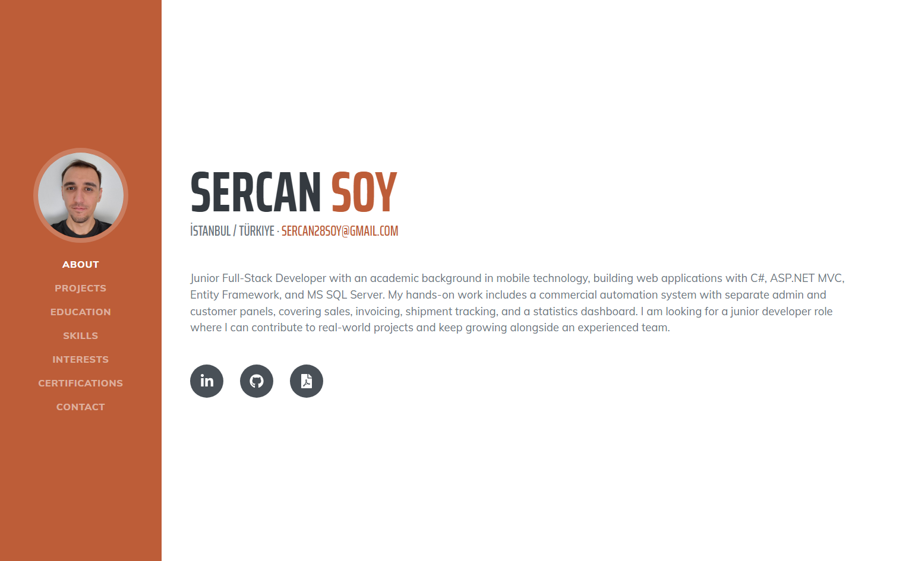
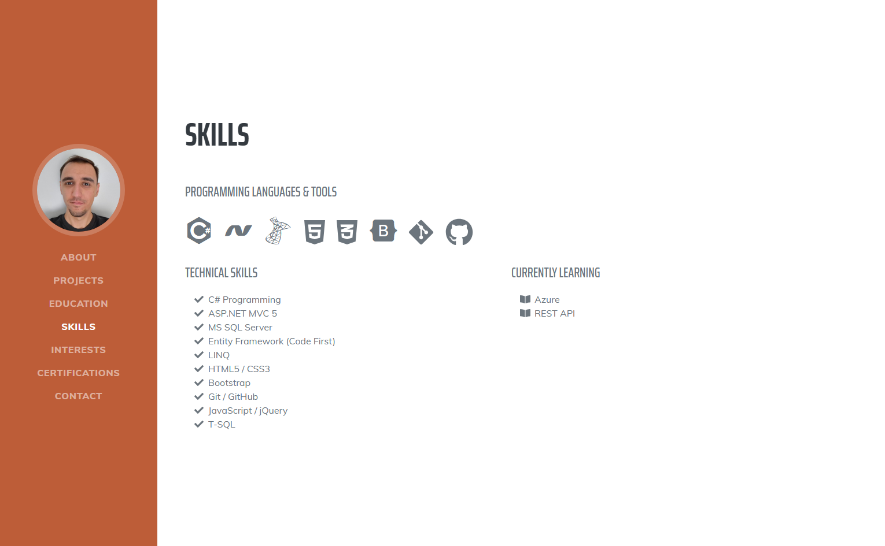
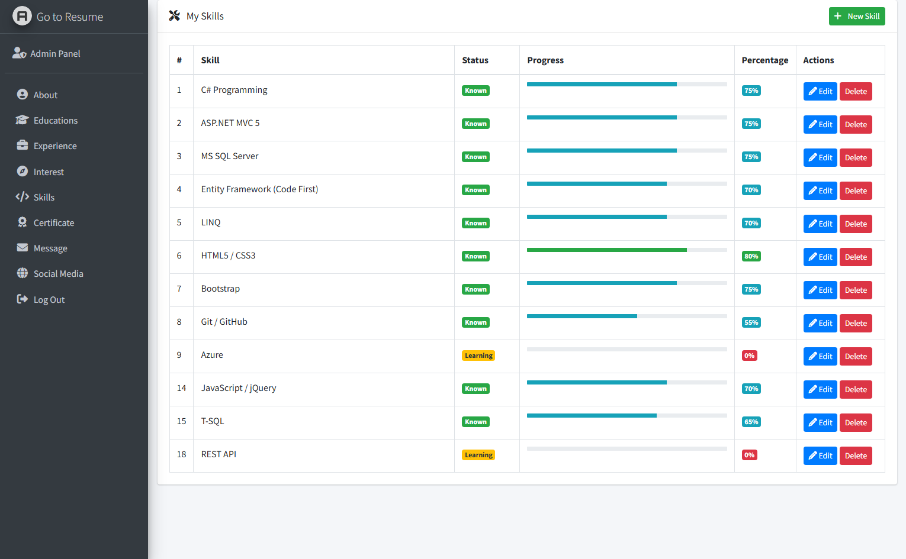
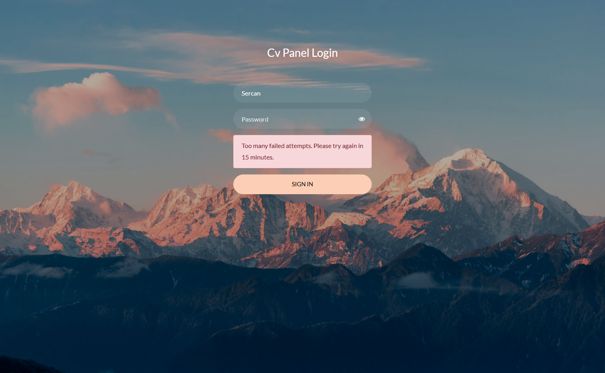
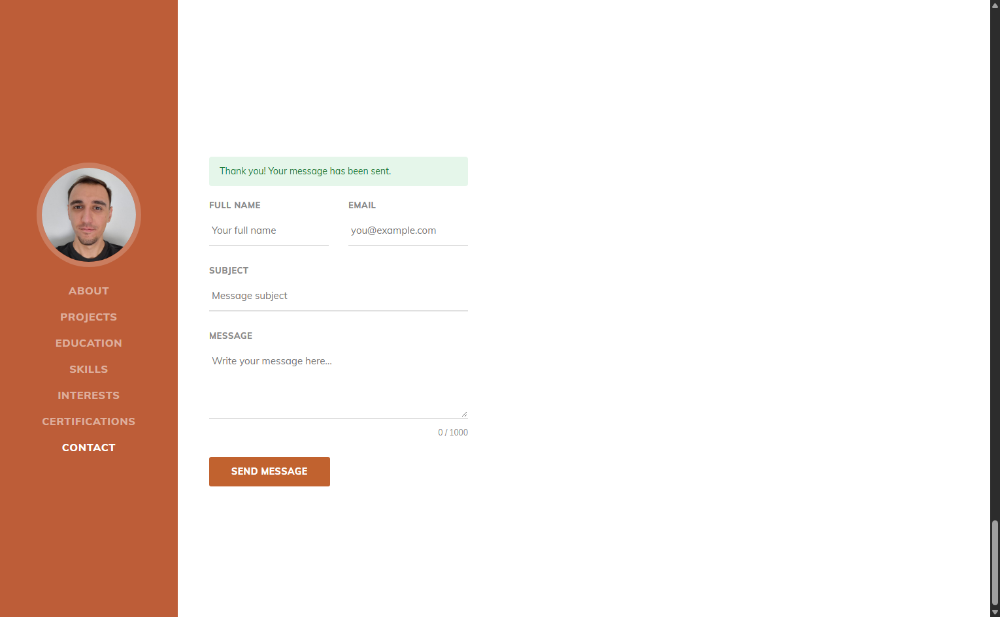

# Personal Resume Website with Admin Panel

A dynamic personal resume (CV) website built with **ASP.NET MVC 5**, **Entity Framework 6 (Code First)** and **MS SQL Server**. All content shown on the public page (about, experience, education, skills, interests, certificates, social links) is stored in the database and managed through a secured admin panel, so the site can be updated without touching the code.

> Personal learning project, built while following an ASP.NET MVC course and extended with my own features.

## Features

### Public website
- Single-page resume layout with About, Experience, Education, Skills, Interests, Certificates and Contact sections
- Skills section with technology icons and a separate **"Currently Learning"** column, both driven by the database
- Social media links that can be switched on or off from the admin panel
- Downloadable CV (PDF) button next to the social links
- Contact form that stores visitor messages in the database
- Custom 404 and error pages

### Admin panel
- Cookie-based login (Forms Authentication)
- CRUD management for About, Experience, Education, Skills, Interests, Certificates and Social Media
- Skills editor with icon class, proficiency slider and a "currently learning" switch
- Inbox for messages sent through the contact form
- Admin user management (create, update, delete) with protection against deleting your own account or the last remaining admin

## Security

Security was a deliberate focus of this project:

- **Secure by default**: a global `[Authorize]` filter protects every action; only the public site, login and error pages are marked `[AllowAnonymous]`
- **Password hashing** with BCrypt (BCrypt.Net-Next), no plain-text passwords
- **Brute-force protection**: login is locked for 15 minutes after 5 failed attempts (per IP and username)
- **CSRF protection**: `[ValidateAntiForgeryToken]` on all POST actions, with a token in every form
- **Contact form spam protection**: a hidden honeypot field that real visitors never fill in, plus a limit of 3 messages per hour per IP address
- **Safe deletes**: delete operations are POST-only with a confirmation prompt, never plain links
- **Generic login errors** that do not reveal whether a username exists
- **Hardened responses**: HttpOnly cookies, hidden ASP.NET/MVC version headers, `X-Content-Type-Options` and `X-Frame-Options` headers
- **Server-side validation** with data annotations and length limits on entities
- Razor encoding is used everywhere (no `Html.Raw`) to prevent XSS

## Tech Stack

| Layer | Technology |
|---|---|
| Framework | ASP.NET MVC 5 (.NET Framework 4.7.2) |
| Language | C# |
| ORM | Entity Framework 6 (Code First + Migrations) |
| Database | Microsoft SQL Server (SQL Server Express) |
| Authentication | Forms Authentication, BCrypt.Net-Next |
| Front end | Razor, Bootstrap 5, jQuery |
| Pattern | Generic repository |

### Templates used
- Public site: [Start Bootstrap Resume](https://startbootstrap.com/theme/resume)
- Admin panel: [AdminLTE 3.0.4](https://adminlte.io/)
- Login page: Login Form 20 by Colorlib

## Project Structure

```
ResumeProject/
├── Controllers/      # MVC controllers (Home, Login, Admin, Skills, ...)
├── Models/           # Entities and DbContext
├── Repositories/     # Generic repository classes
├── Views/            # Razor views (public site, admin panel, errors)
├── Migrations/       # EF Code First migrations
└── App_Start/        # Routing and bundle configuration
```

## Getting Started

### Prerequisites
- Visual Studio 2019 or later with the **ASP.NET and web development** workload
- SQL Server Express (or any SQL Server instance)

### Setup
1. Clone the repository
   ```bash
   git clone https://github.com/Sercansoy/cv-website.git
   ```
2. Open `ResumeProject.sln` in Visual Studio and restore the NuGet packages.
3. Check the connection string in `Web.config` and change it if needed:
   ```xml
   <add name="Context"
        connectionString="Data Source=.\SQLEXPRESS; Initial Catalog=DbResume; Integrated Security=True;"
        providerName="System.Data.SqlClient" />
   ```
4. Create the database from the Package Manager Console:
   ```
   Update-Database
   ```
5. Create the first admin user. There is no seed data, so insert a row into the `Admins` table with a `User` name and a **BCrypt-hashed** `Password` (plain-text passwords will be rejected at login). You can generate a hash with `BCrypt.Net.BCrypt.HashPassword("your-password")` in a throwaway console app.
6. Press **F5** and open `/Login/Index` to sign in, then fill in your resume content from the admin panel.

## Screenshots

| Public Website | Skills Section |
|---|---|
|  |  |

| Admin Panel: Skills | Login Protection |
|---|---|
|  |  |

| Contact Form |
|---|
|  |

## Roadmap

- [ ] Deploy to Azure App Service with HTTPS enforced
- [ ] Detect the real client IP behind Azure's proxy so the login lockout and contact form limit work per visitor
- [ ] Unit tests for controllers and repositories
- [ ] Move configuration secrets to environment variables for production

## Author

**Sercan Soy**
[GitHub](https://github.com/Sercansoy)
[Linked](https://www.linkedin.com/in/sercan-soy-16a5603b3)
